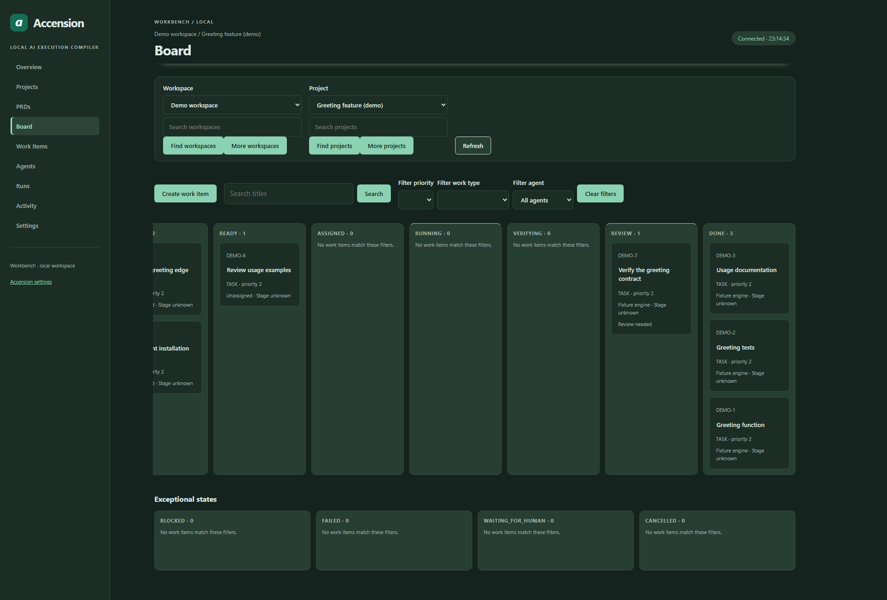
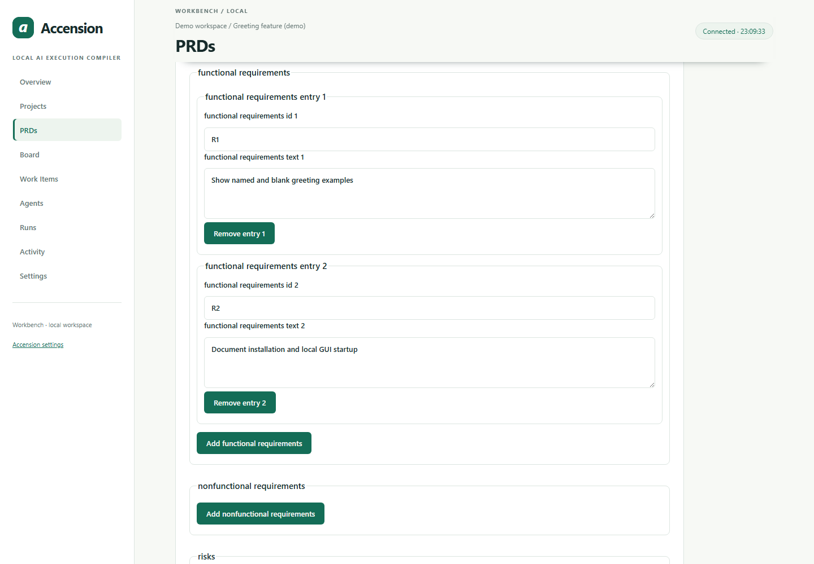
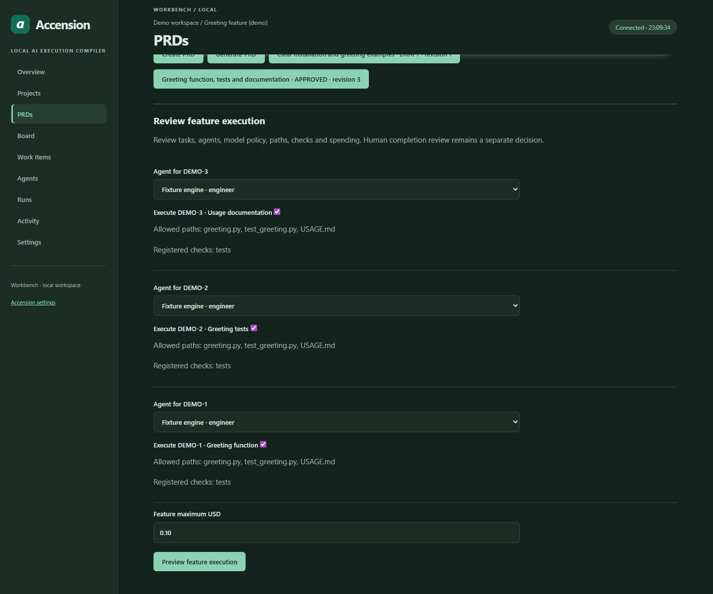
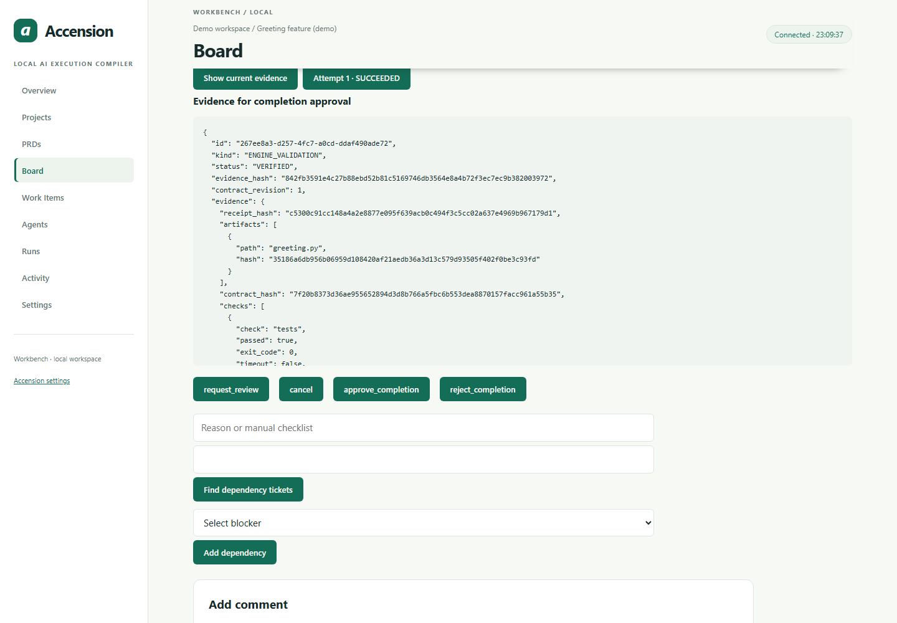

# Accension


[](https://github.com/Jigsaw777/accension/actions/workflows/tests.yml)
[](pyproject.toml)
[](LICENSE)

**Accension routes AI tasks to suitable models and helps you plan, execute, review and track development work.** It runs on your computer, with local models or optional cloud providers. No Accension account is required.

**Version 1.1.0 adds Workbench:** projects, product requirements documents (PRDs), dependent work items, approved execution and completion review. Routing and Workbench are two views of the same application. [Release notes](docs/RELEASE_NOTES.md) · [Upgrade notes](docs/UPGRADE_NOTES.md).

Windows, Linux and macOS support the Python application. Windows also has bundled Python installers. Published Windows downloads are **unsigned branch prereleases**, not a stable numbered release.

## Why Accension exists

Several AI tools can scatter your plans, model settings and code changes. Accension connects planning to execution: choose privacy and spending limits, assign work, inspect actual checks and keep a record of what happened. It coordinates dependent tasks without treating a model's success message as proof of completion.

Costs and model quality depend on your task and providers. Extra planning, checking or repairs can increase spending.

## At a glance

| Need | What Accension provides |
|---|---|
| Choose a model | Routing based on capabilities, quality evidence, privacy, price and budget; local and optional cloud providers |
| Plan a feature | Structured PRDs, reviewed planning proposals and dependent work items |
| Control execution | Configured agents, registered repositories, allowed paths, trusted checks and current approval |
| Verify results | Independent checks, artifacts, execution receipts and applicable human completion review |
| Track work | Board, attempts, activity and agent performance; unknown costs remain unknown |
| Use your tools | CLI, local browser, MCP, trusted skills and provider plugins |
| Use another device | Optional HTTPS LAN with pairing and explicit workspace grants |

## See Workbench



*Workbench organizes development work into dependent items and shows their recorded execution state. This isolated greeting demo uses mock inference and real local tests. Its metrics are demonstration data, not production benchmarks.*

[Gallery and provenance](docs/guides/screenshots/feature-showcase.md) · [Step-by-step walkthrough](docs/guides/workbench.md) · [Mobile board](docs/guides/screenshots/feature-board-dark-mobile.png)

## Choose how to start

| You want to… | Start here |
|---|---|
| Use Windows without installing Python | [Windows quick start](#windows-quick-start) |
| Use the CLI and browser on Windows, Linux or macOS | [Python quick start](#python-quick-start) |
| Change Accension or add a provider | [Contributor setup](CONTRIBUTING.md), [source map](docs/guides/architecture.md#source-map) |

## Windows quick start

Requires **Windows 10 1809 or later, x64**. No separate Python installation or administrator rights are required.

1. Download the [latest successful main installer](https://github.com/Jigsaw777/accension/releases/download/windows-main/Accension-latest-windows-x64.exe) and its [SHA-256 file](https://github.com/Jigsaw777/accension/releases/download/windows-main/Accension-latest-windows-x64.exe.sha256).
2. In PowerShell, run the command below and compare its hash with the SHA-256 file. The installer is unsigned; verify its origin and checksum before deciding whether to run it if Windows shows an unknown publisher.
3. Run the installer. Open **Accension** from the Start menu to open Workbench at `http://127.0.0.1:8765/ui/workbench`.
4. Choose **Accension settings** to configure providers, models, routing and repositories. **Open Workbench** returns to projects.
5. Try the [first project tutorial](#first-project-no-model-needed). Use **Stop Accension** in the Start menu to stop the service.

```powershell
Get-FileHash .\Accension-latest-windows-x64.exe -Algorithm SHA256
```

Download and run a newer installer to update; installed applications do not update themselves silently. `windows-main` follows successful `main` builds and can change without the package version changing. Check the accompanying source manifest. For uninstall, profile locations, recovery and development builds, read the [Windows guide](docs/guides/windows.md).

## Python quick start

Requires Python **3.11+**, Git and a source checkout. These commands install that checkout; they do not assume publication on PyPI. Download dependencies once before offline use.

```sh
git clone https://github.com/Jigsaw777/accension.git
cd accension
python -m venv .venv
```

Activate using your shell:

```powershell
# Windows PowerShell
.\.venv\Scripts\Activate.ps1
```

```sh
# Linux / macOS
source .venv/bin/activate
```

Then, in either shell:

```sh
python -m pip install ".[vault]"
accs init
accs start --background
accs workbench open
```

`init` sets up your profile and prompts for repository settings. `start` runs the local service; `workbench open` opens the board. These management commands make no model calls and do not edit repository source. You can create projects without a model.

```sh
accs status
accs doctor
accs stop
```

`status` reports service state, `doctor` diagnoses configuration, and `stop` stops the service. Closing the browser leaves it running. If activation fails, use the environment's executable directly; see the [complete quick start](docs/guides/quickstart.md).

## First project: no model needed

This walkthrough makes no inference calls and edits no repository files. It stores project data locally.

1. Open Workbench. Select **Personal**, open **Projects**, and save **Greeting demo** with ticket prefix **DEMO**. Select it in the Project filter.
2. Open **Board → Create work item**. Name it **Document greeting examples**. Set objective: “Show named and blank greeting inputs.”
3. Set acceptance criteria: “Both examples are documented.” Set definition of done: “Examples reviewed.” Save.
4. Open the ticket to inspect its contract. Leave it in **BACKLOG** while preparing its scope and required checks.
5. Return to **Board**. The ticket remains after refresh. Follow the [Workbench tutorial](docs/guides/workbench.md) to add a PRD, dependencies and approved execution.

For a separate disposable demonstration, use a [developer installation](CONTRIBUTING.md):

```sh
python scripts/demo_workbench.py --feature
```

This uses mock inference and a scripted fixture operator, runs real local checks, verifies receipts after reopening and cleans up. It calls no paid provider and never uses your working profile.

## How the AI workflow works

```mermaid
flowchart LR
    Idea[Requirement] --> PRD[PRD and revision review]
    PRD --> Items[Reviewed work item import]
    Items --> Dependencies[Dependencies satisfied]
    Dependencies --> Agent[Agent assignment]
    Agent --> Approval[Execution approval]
    Approval --> Run[Actual execution]
    Run --> Checks[Independent validation]
    Checks --> Review[Required completion review]
    Review --> Done[Done]
```



A **PRD** states the problem, scope and acceptance criteria. A **work item** turns part of it into a bounded task. Dependencies determine when it can proceed. An **agent** performs execution; routing chooses eligible **models** for its roles.

PRD approval accepts requirements. Import creates work items. Execution approval permits the current scope to run. Completion review accepts the resulting evidence. Each is separate. Assignment grants no execution authority. Failed checks, stale approvals or missing review prevent **DONE**.

## Workbench

| View | What to do there |
|---|---|
| Projects | Organize work and select its registered repository |
| PRDs | Write/generate requirements, review revisions and preview decomposition |
| Board / work items | Inspect contracts, dependencies, assignments and states |
| Agents | Configure workers/model choices; inspect performance |
| Runs | Inspect attempts, checks, artifacts and receipts |
| Activity / Settings | Follow changes; manage workspace settings and optional device pairing |



*This synthetic draft makes requirements reviewable before task import.*



*Review tasks, model policy and spending before starting. Completion remains a separate review.*

See the [full walkthrough](docs/guides/workbench.md), [delivery/recovery guide](docs/guides/feature-delivery.md) and [agent performance capture](docs/guides/screenshots/feature-agents-dark-desktop.png).

## AI models and routing

A **provider** makes models available; a **model** performs inference. A **role** describes a responsibility, such as coder or reviewer. An **agent** is a configured worker. The scheduler coordinates tasks. Skills supply guidance; tools perform authorized actions. [Comparison and Android example](docs/guides/models-and-routing.md).

Open **Accension settings** or run `accs ui` for model setup at `/ui`. Connect Ollama or another provider, check capabilities/prices, and choose a routing policy. Accension does not download model weights. Missing evidence or unknown prices can make models ineligible.

Local inference keeps model calls on your machine. Authorized cloud inference can send project context externally even though the database stays local. Repository privacy, provider policy, egress and spending limits all apply. [Providers](PROVIDERS.md) · [Routing policy](ROUTING_POLICY.md).

## Execution and verification

For the greeting example, register a repository and trusted `tests` command, allow `greeting.py`, and require named/blank inputs to pass. An approved attempt freezes that contract. The Engine applies permitted changes and runs registered checks. A failed test blocks completion; inspect the attempt before retrying.



*Real local tests ran with mock model output. Passing tests provide evidence; applicable human review still determines completion.*

A receipt records what ran, checks and artifacts. Required review binds to current evidence; changed contracts/results need fresh decisions. Interrupted workers go through recovery. [Delivery behavior](docs/guides/feature-delivery.md) · [Receipts](docs/EXECUTION_RECEIPTS.md).

## Privacy and security

Configuration and history stay local; the service listens on loopback by default. Cloud use is optional and can send permitted context to providers. LAN is opt-in and requires HTTPS, pairing and workspace grants. Remote clients cannot administer provider credentials or repositories.

Credentials use OS storage or explicit environment references. Checks, plugins, skills, credential commands and MCP processes are trusted software. Inspect what you install and authorize: arbitrary extensions are not sandboxed. Allowed paths and validation constrain execution; they do not make model output risk-free.

[Privacy](PRIVACY.md) · [Security and disclosure](SECURITY.md) · [LAN setup](docs/guides/workbench.md#pair-a-second-device).

## Integrations

Use the browser, [CLI](docs/CLI.md), or [MCP](MCP.md). [Codex](CODEX_SETUP.md) and [Claude](CLAUDE_SETUP.md) guides explain supported transports. Desktop assistants are not automatically independently controllable Workbench agents. Machine clients cannot grant execution or completion approval.

A human operating the authenticated local CLI can use its explicit approval commands. These are human decisions, separate from ordinary machine API/MCP calls. Feature-batch approval uses the human browser flow. [CLI approval reference](docs/CLI.md#workbench-commands).

[Skills and presets](docs/SKILLS.md) supply reusable instructions; [provider plugins](docs/PLUGIN_SDK.md) extend model access. Validate live provider/client combinations in your intended environment.

## Upgrade from 1.0.0

1.1.0 adds persistent Workbench planning, delivery and review alongside existing routing. Product **1.1.0**, database schema **9**, configuration schema **2** and AXIR schema **1** are distinct. Existing CLI aliases and `local_ai_router` imports remain supported.

Stop active work and back up your profile. Migrations create a verified backup. **Older binaries must not open upgraded databases.** Restoring a compatible backup loses later database changes and does not undo repository edits. [Upgrade procedure](docs/UPGRADE_NOTES.md) · [Changelog](CHANGELOG.md).

## FAQ

| Question | Answer |
|---|---|
| Is Accension free? | Apache-2.0 software. Cloud providers can charge; local inference uses hardware/electricity. |
| Do I need a cloud account? | No. Manual planning needs no model; local models need no cloud account. |
| Can I use it offline? | After dependencies/local models are installed, yes for local workflows. Cloud needs a network. |
| Does it download an AI model? | No. Install/load weights through your provider, for example Ollama. |
| Can it use Ollama? | Yes. Configure Ollama and discover available models. |
| Is my code stored online? | The profile is local. Authorized cloud inference can transmit selected context. |
| Can it write code automatically? | Eligible workers execute approved bounded tasks with checks and required review. |
| What does approval mean? | Current human decisions about requirements, scope or completion evidence; each is separate. |
| Is it a Jira replacement? | It provides planning/execution tracking, not full Jira compatibility. |
| Can it work with Codex and Claude? | Through documented integrations; capabilities and approval rules differ. |
| Can I use another device? | With opt-in HTTPS LAN, pairing and granted permissions. |
| Does it require Docker or a GPU? | Neither for Accension itself. Model runtimes have their own requirements. |
| Where are settings stored? | Windows: `%APPDATA%\accension`; otherwise `~/.config/accension`; `ROUTER_HOME` can override. |
| How do I report a bug? | Run `accs doctor`, read [troubleshooting](TROUBLESHOOTING.md), open an issue with redacted details. |

## Community and contribution

[Report bugs or request features](https://github.com/Jigsaw777/accension/issues). Start with [development setup/checks](CONTRIBUTING.md) and the [architecture/source map](docs/guides/architecture.md). PRs require review and CI; passing checks does not automatically merge contributions. Use [Security](SECURITY.md) for vulnerability disclosure.

## Documentation

The [public documentation index](docs/README.md) groups installation, workflows, routing, security, APIs and contributor references. Technical details stay in canonical guides. Private engineering prompts/task notes stay local.

Licensed under [Apache-2.0](LICENSE). Copyright 2026 Sourik Ganguly and Accension contributors. [Third-party notices](THIRD_PARTY_NOTICES.md).
