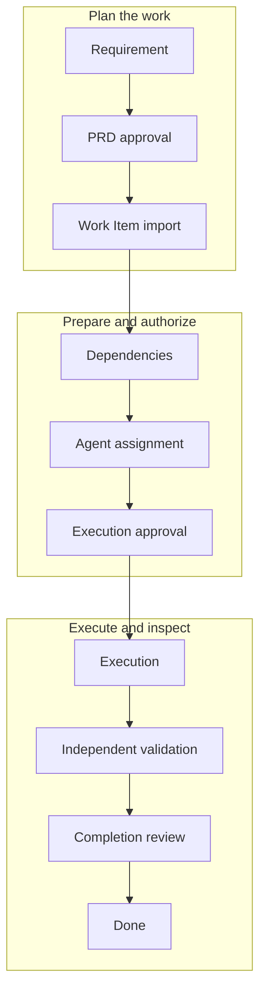

# Accension — Your local-first AI engineering Workbench


**Turn software requirements into structured plans, assign work to AI agents, and track execution through testing and review.**

[](https://github.com/Jigsaw777/accension/actions/workflows/tests.yml)
[](pyproject.toml)
[](LICENSE)

Accension is open source, self-hosted and local-first. No hosted Accension account is required. Use local models or optional cloud providers; authorized cloud inference can send project context externally.

**Version 1.1.0 adds Workbench:** projects, product requirements documents (PRDs), dependent tasks, approved execution and completion review. Routing and Workbench are two views of the same application. [Release notes](docs/RELEASE_NOTES.md) · [Upgrade notes](docs/UPGRADE_NOTES.md).

[Get started](#get-started) · [Workbench guide](docs/guides/workbench.md) · [Documentation](docs/README.md) · [Releases](https://github.com/Jigsaw777/accension/releases)

<a id="why-accension-exists"></a>

## The problem

AI can write code, but delivering a feature also needs a plan, dependencies, permissions, tests and review. Those decisions often get scattered across chats, terminals and project boards. Accension connects them and keeps evidence of what actually ran.

<a id="see-workbench"></a>

## See Accension in action


<a id="how-the-ai-workflow-works"></a>

## From requirement to verified work

A **PRD** states the problem, scope and acceptance criteria. A **Work Item** turns part of it into a bounded task. Dependencies determine when it can proceed. An **agent** performs execution; routing chooses eligible **models** for its roles.



**[Watch the complete 51-second demo](docs/media/accension-demo.mp4)** · [8-second preview](docs/media/accension-demo-preview.gif) · [Gallery and capture provenance](docs/guides/screenshots/feature-showcase.md)

*Real browser recording of an isolated greeting project. Deterministic mock inference and a fixture operator; real local tests and persisted receipts. Completed results are identified as recorded attempts. Demo metrics are not production benchmarks.*

For “build a greeting function with tests and documentation,” each step has a separate purpose:

| Stage | What happens |
|---|---|
| Requirement and PRD approval | Write the problem, scope and acceptance criteria; review the requirements. |
| Work Item import | Review decomposition and create bounded, persistent tasks. No code runs yet. |
| Dependencies | Implementation precedes tests, which precede documentation in this example. |
| Agent assignment | Select an eligible configured worker. Assignment grants no execution authority. |
| Execution approval | Review the repository, allowed files, registered checks and spending for the current scope. |
| Execution and validation | Record an actual attempt; run independent local checks and retain artifacts/receipts. |
| Completion review | Inspect current evidence and approve or reject completion when required. |

<a id="at-a-glance"></a>

## What can Accension do?

| Need | What Accension provides |
|---|---|
| Plan a feature | Projects, structured PRDs, reviewed decomposition and dependent Work Items |
| Choose models and workers | Capability, quality, privacy, price and budget eligibility; configured agents |
| Control and verify execution | Registered repositories, allowed paths, trusted checks, attempts and receipts |
| Track work | Board, activity, project and agent dashboards; unknown costs remain unknown |
| Use your tools | Browser, CLI, MCP, trusted skills, provider plugins and portable AXIR plans |
| Use another device | Optional HTTPS LAN with pairing and explicit workspace grants |

Tasks can fail, block or need human intervention. Costs and model quality depend on your task and providers. Extra planning, checking and repair can increase spending. Accension does not automatically commit, push or merge changes.

<a id="choose-how-to-start"></a>

## Get started

Manual project and Work Item creation needs no model or paid provider. Use the Windows installer, or install the Python application on Windows, Linux or macOS.

| You want to… | Start here |
|---|---|
| Use Windows without installing Python | [Windows quick start](#windows-quick-start) |
| Use the CLI and browser on Windows, Linux or macOS | [Python quick start](#python-quick-start) |
| Change Accension or add a provider | [Contributor setup](CONTRIBUTING.md), [source map](docs/guides/architecture.md#source-map) |

### Windows quick start

Requires **Windows 10 1809 or later, x64**. No separate Python installation or administrator rights are required.

Published Windows downloads are **unsigned branch prereleases**, not a stable numbered release. They include bundled Python.

1. Download the [latest successful main installer](https://github.com/Jigsaw777/accension/releases/download/windows-main/Accension-latest-windows-x64.exe) and its [SHA-256 file](https://github.com/Jigsaw777/accension/releases/download/windows-main/Accension-latest-windows-x64.exe.sha256).
2. In PowerShell, run the command below and compare its hash with the SHA-256 file. The installer is unsigned; verify its origin and checksum before deciding whether to run it if Windows shows an unknown publisher.
3. Run the installer. Open **Accension** from the Start menu to open Workbench at `http://127.0.0.1:8765/ui/workbench`.
4. Choose **Accension settings** to configure providers, models, routing and repositories. **Open Workbench** returns to projects.
5. Try the [first project tutorial](#your-first-project). Use **Stop Accension** in the Start menu to stop the service.

```powershell
Get-FileHash .\Accension-latest-windows-x64.exe -Algorithm SHA256
```

Download and run a newer installer to update; installed applications do not update themselves silently. `windows-main` follows successful `main` builds and can change without the package version changing. Check the accompanying source manifest. For uninstall, profile locations, recovery and development builds, read the [Windows guide](docs/guides/windows.md).

### Python quick start

Requires Python **3.11+**, Git and a source checkout. These commands install that checkout; they do not assume publication on PyPI. Download dependencies once before offline use.

```sh
git clone https://github.com/Jigsaw777/accension.git
cd accension
python -m venv .venv
```

Activate using your shell:

```powershell
# Windows PowerShell
.\.venv\Scripts\Activate.ps1
```

```sh
# Linux / macOS
source .venv/bin/activate
```

Then, in either shell:

```sh
python -m pip install ".[vault]"
accs init
accs start --background
accs workbench open
```

`init` sets up your profile and prompts for repository settings. `start` runs the local service; `workbench open` opens the board. These management commands make no model calls and do not edit repository source. You can create projects without a model.

```sh
accs status
accs doctor
accs stop
```

`status` reports service state, `doctor` diagnoses configuration, and `stop` stops the service. Closing the browser leaves it running. If activation fails, use the environment's executable directly; see the [complete quick start](docs/guides/quickstart.md).

<a id="first-project-no-model-needed"></a>

## Your first project

This walkthrough makes no inference calls and edits no repository files. It stores project data locally.

1. Open Workbench. Select **Personal**, open **Projects**, and save **Greeting demo** with ticket prefix **DEMO**. Select it in the Project filter.
2. Open **Board → Create work item**. Name it **Document greeting examples**. Set objective: “Show named and blank greeting inputs.”
3. Set acceptance criteria: “Both examples are documented.” Set definition of done: “Examples reviewed.” Save.
4. Open the ticket to inspect its contract. Leave it in **BACKLOG** while preparing its scope and required checks.
5. Return to **Board**. The ticket remains after refresh. Follow the [Workbench tutorial](docs/guides/workbench.md) to add a PRD, dependencies and approved execution.

For a separate disposable demonstration, use a [developer installation](CONTRIBUTING.md):

```sh
python scripts/demo_workbench.py --feature
```

This uses mock inference and a scripted fixture operator, runs real local checks, verifies receipts after reopening and cleans up. It calls no paid provider and never uses your working profile.

<a id="workbench"></a>

## How the Workbench works

| View | What to do there |
|---|---|
| Projects | Organize work and select its registered repository |
| PRDs | Write/generate requirements, review revisions and preview decomposition |
| Board / Work Items | Inspect task contracts, dependencies, assignments and current states |
| Agents | Configure workers/model choices and inspect eligibility/performance |
| Runs | Inspect attempts, checks, artifacts and receipts |
| Activity / Settings | Follow changes; manage workspace settings and optional device pairing |

PRD approval accepts requirements. Import creates tasks. Execution approval permits the current scope. Completion review accepts current evidence. Changed contracts or results can require fresh decisions. Failed checks, stale approvals or missing required review prevent **DONE**.


*This synthetic draft makes requirements reviewable before task import.*


*Review tasks, model policy and spending before starting. Completion remains a separate review.*

[Full walkthrough](docs/guides/workbench.md) · [Delivery and recovery](docs/guides/feature-delivery.md) · [Agent performance](docs/guides/screenshots/feature-agents-dark-desktop.png) · [Mobile board](docs/guides/screenshots/feature-board-dark-mobile.png)

<a id="ai-models-and-routing"></a>

## Models, providers, agents and skills

A **provider** makes models available; a **model** performs inference. A **role** describes a responsibility, such as coder or reviewer. An **agent** is a configured worker. The scheduler coordinates tasks. Skills supply guidance; tools perform authorized actions. [Comparison and Android example](docs/guides/models-and-routing.md).

Open **Accension settings** or run `accs ui` for model setup at `/ui`. Connect Ollama or another provider, check capabilities/prices, and choose a routing policy. Accension does not download model weights. Missing evidence or unknown prices can make models ineligible.

Local inference keeps model calls on your machine. Authorized cloud inference can send project context externally even though the database stays local. Repository privacy, provider policy, egress and spending limits all apply. [Providers](PROVIDERS.md) · [Routing policy](ROUTING_POLICY.md).

<a id="execution-and-verification"></a>

## Why verification matters

**A model reporting success does not automatically mean the work is complete.**

For the greeting example, register a repository and trusted `tests` command, allow `greeting.py`, and require named/blank inputs to pass. An approved attempt freezes that contract. The Engine applies permitted changes and runs registered checks. A failed test blocks completion; inspect the attempt before retrying.


*Real local tests ran with mock model output. Passing tests provide evidence; applicable human review still determines completion.*

A receipt records what ran, checks and artifacts. Applicable human review binds to the current evidence. Interrupted workers go through recovery. Allowed paths, protected repository paths and validation constrain execution; they do not guarantee correctness or sandbox arbitrary code.

[Delivery behavior](docs/guides/feature-delivery.md) · [Receipts](docs/EXECUTION_RECEIPTS.md)

## Privacy and security

Configuration and history stay local; the service listens on loopback by default. Cloud use is optional and can send permitted context to providers. LAN is opt-in and requires HTTPS, pairing and workspace grants. Remote clients cannot administer provider credentials or repositories.

Credentials use OS storage or explicit environment references. Checks, plugins, skills, credential commands and MCP processes are trusted software. Inspect what you install and authorize: arbitrary extensions are not sandboxed. Allowed paths and validation constrain execution; they do not make model output risk-free.

[Privacy](PRIVACY.md) · [Security and disclosure](SECURITY.md) · [LAN setup](docs/guides/workbench.md#pair-a-second-device).

## Integrations

Use the browser, [CLI](docs/CLI.md), or [MCP](MCP.md). [Codex](CODEX_SETUP.md) and [Claude](CLAUDE_SETUP.md) guides explain supported transports. Desktop assistants are not automatically independently controllable Workbench agents. Machine clients cannot grant execution or completion approval.

A human operating the authenticated local CLI can use its explicit approval commands. These are human decisions, separate from ordinary machine API/MCP calls. Feature-batch approval uses the human browser flow. [CLI approval reference](docs/CLI.md#workbench-commands).

[Skills and presets](docs/SKILLS.md) supply reusable instructions; [provider plugins](docs/PLUGIN_SDK.md) extend model access. Validate live provider/client combinations in your intended environment.

<a id="upgrade-from-100"></a>

## What's new in 1.1.0?

1.1.0 adds persistent Workbench planning, delivery and review alongside existing routing. Product **1.1.0**, database schema **9**, configuration schema **2** and AXIR schema **1** are distinct. Existing CLI aliases and `local_ai_router` imports remain supported.

Stop active work and back up your profile. Migrations create a verified backup. **Older binaries must not open upgraded databases.** Restoring a compatible backup loses later database changes and does not undo repository edits. [Upgrade procedure](docs/UPGRADE_NOTES.md) · [Changelog](CHANGELOG.md).

<a id="faq"></a>

## Frequently asked questions

| Question | Answer |
|---|---|
| Is Accension free? | Apache-2.0 software. Cloud providers can charge; local inference uses hardware/electricity. |
| Do I need a cloud account? | No. Manual planning needs no model; local models need no cloud account. |
| Can I use it offline? | After dependencies/local models are installed, yes for local workflows. Cloud needs a network. |
| Does it download an AI model? | No. Install/load weights through your provider, for example Ollama. |
| Can it use Ollama? | Yes. Configure Ollama and discover available models. |
| Is my code stored online? | The profile is local. Authorized cloud inference can transmit selected context. |
| Can it write code automatically? | Eligible workers execute approved bounded tasks with checks and required review. |
| What does approval mean? | Current human decisions about requirements, scope or completion evidence; each is separate. |
| Is it a Jira replacement? | It provides planning/execution tracking, not full Jira compatibility. |
| Can it work with Codex and Claude? | Through documented integrations; capabilities and approval rules differ. |
| Can I use another device? | With opt-in HTTPS LAN, pairing and granted permissions. |
| Does it require Docker or a GPU? | Neither for Accension itself. Model runtimes have their own requirements. |
| Where are settings stored? | Windows: `%APPDATA%\accension`; otherwise `~/.config/accension`; `ROUTER_HOME` can override. |
| How do I report a bug? | Run `accs doctor`, read [troubleshooting](TROUBLESHOOTING.md), open an issue with redacted details. |

<a id="community-and-contribution"></a>

## Contributing

[Report bugs or request features](https://github.com/Jigsaw777/accension/issues). Start with [development setup/checks](CONTRIBUTING.md) and the [architecture/source map](docs/guides/architecture.md). PRs require review and CI; passing checks does not automatically merge contributions. Use [Security](SECURITY.md) for vulnerability disclosure.

## Documentation

The [public documentation index](docs/README.md) groups installation, workflows, routing, security, APIs and contributor references. Technical details stay in canonical guides. Private engineering prompts/task notes stay local.

## License

Licensed under [Apache-2.0](LICENSE). Copyright 2026 Sourik Ganguly and Accension contributors. [Third-party notices](THIRD_PARTY_NOTICES.md).
