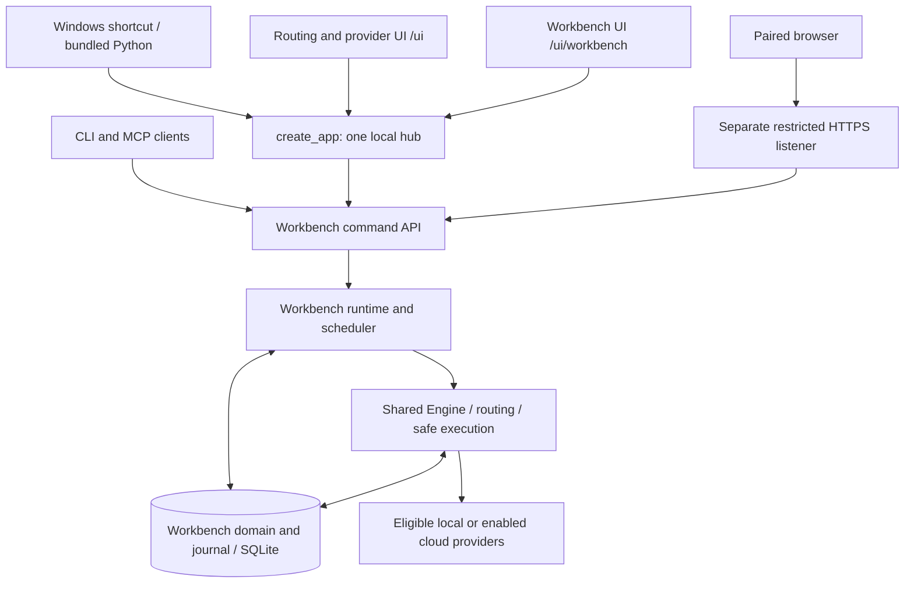

# Workbench architecture and source map

For contributors and developers exploring ownership. No prior knowledge of Workbench internals is required. [Documentation index](../README.md) · [Contributor setup](../../CONTRIBUTING.md).

The browser is a view of the local service. Routing settings and Workbench read the same authoritative configuration/history. CLI and MCP adapt commands to that service; optional LAN exposes a restricted HTTPS listener backed by the same runtime. The scheduler coordinates work, the Engine performs model calls and validated execution, and SQLite retains state/events.

Accension owns one Engine and one persistent local store. Workbench adds project and work-item lifecycle records while reusing the Engine's routing, validation, budgets, repository locks and receipts. Its execution API is versioned independently from private implementation handoff documents.

## Source map

| Concern | Owner |
|---|---|
| Service lifecycle / host app | `service.py`, `app.py`, `ui.py` |
| Routing UI and shared theme/logo | `static/index.html`, `app.js`, `style.css`, `logo.svg` |
| Local/remote Workbench views | `static/workbench*.html`, `workbench*.js`, `workbench.css` |
| Domain validation and transitions | `workbench/schema.py`, `service.py`, `policy.py` |
| SQLite state and durable journal | `workbench/store.py`, `events.py`; core `store.py` / `db_migrations.py` |
| Runtime ownership and scheduling | `workbench/runtime.py`, `scheduler.py`, `agents.py` |
| Frozen attempts, artifacts, review and recovery | `workbench/execution.py`, `retention.py`; existing Engine helpers |
| Planning / templates | `workbench/planning.py`, `templates.py`, `data/templates/*.yaml` |
| HTTP / CLI / MCP interfaces | `workbench/api.py`, `client.py`, `cli.py`, `mcp.py` |
| Paired-device trust and listener | `workbench/devices.py`, `lan.py` |
| Packaged role prompts | `data/prompts/<role>/v1.txt`; loaded by `engine.py` |
| Windows packaging and proof | `installer/windows/`, `scripts/build_windows_installer.py`, `smoke_windows_installer.py` |
| Public guides / synthetic captures | `docs/guides/`, `docs/guides/screenshots/` |

Paths above are relative to `src/local_ai_router` unless they identify root installer/scripts/guides directories. Keep these Python imports stable; application history belongs in Git and API/schema contracts, not copied runtime version folders. Tests mirror the domain modules and use packaged prompt defaults.

## Version boundaries

The public package reports 1.1.0; database schema is 9, configuration schema is 2 and AXIR schema is 1. These version different objects. Migrations require verified backups. Schema 8 adds activity, model bindings and metrics; schema 9 adds feature delivery, grants and budget reservations. Role prompts use existing `v1.txt` names and content hashes. Private operator overrides do not replace packaged defaults in distribution.

Local engineering handoffs use semantic-version folders and a `latest.json` pointer. Their architecture, task sequence and evidence apply only after checking the current source and user instruction. They are excluded from Git and wheels; end users follow these public guides. New handoffs must inherit earlier contracts explicitly and retain earlier versions unchanged.

## Security and evidence

Loopback browser sessions enforce same origin, CSRF and bounded requests. API tokens and paired-device HttpOnly sessions are separate principals. The HTTPS app allows named assets/routes and granted workspace actions only. The shared logo is inert SVG without scripts or external resources.

Every mutation binds revisions and principal-scoped command IDs. Attempts freeze policy/contracts and record real Engine execution, checks and artifact hashes. Independent verification and evidence-bound review gate completion. Model text, imported plans and layout familiarity provide no execution authority. Journal snapshots support replay and stale-cursor resync; revocation invalidates sessions and grants.

The Windows builder stages fresh package sources and refuses mismatched UI assets. Its manifest records source commit, build time, dependencies and every asset hash. CI performs a real isolated install/upgrade/uninstall before exposing build artifacts. Branch prerelease assets are mutable latest-successful-build pointers; their manifests identify the source snapshot. PR builds cannot update those download pointers.

Read [core architecture](../../ARCHITECTURE.md) and [security](../../SECURITY.md) for routing, gateway, plugin and trusted-command boundaries.
