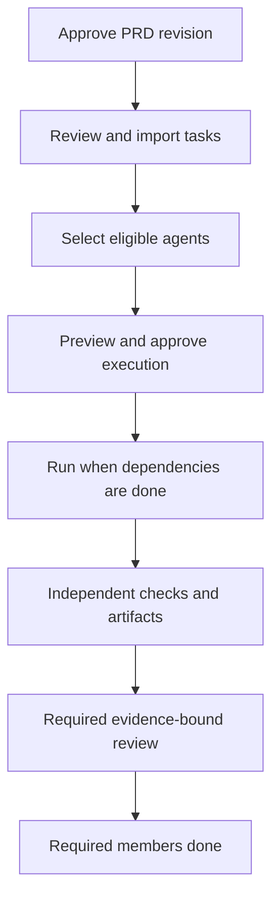
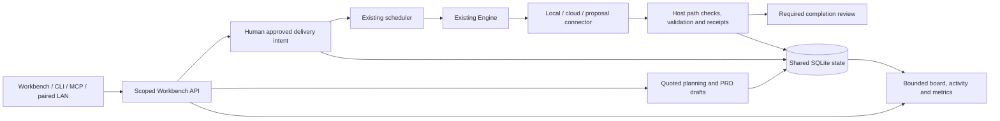

# Feature delivery in Workbench

For developers who have completed the [Workbench tutorial](workbench.md). Requires a registered repository, trusted checks, installed project dependencies and eligible models. [Documentation index](../README.md).

## What each decision means

| Stage | Result | What it does not authorize |
|---|---|---|
| PRD approval | Accepts the current requirements revision | Import or execution |
| Work item import | Creates reviewed task records | Repository edits |
| Agent eligibility / assignment | Finds and selects a permitted worker | Starting work |
| Execution approval | Grants current scope, policy and spending allowance | Accepting the resulting changes |
| Actual execution | Produces an attempt with host checks/artifacts | Automatic completion from model text |
| Verification | Records independent validation | Bypassing required human review |
| Completion review | Accepts/rejects current evidence | Accepting stale evidence |
| Final completion | Required members are DONE | Automatic commit, push or merge |



## Worked example: Greeting demo

Require named/blank inputs to return the expected greeting. Import three tasks: implementation, tests depending on implementation, and usage documentation depending on tests. Each names its permitted files and registered `tests` check. Select an eligible Engine worker and review a feature allowance of USD 0.30 before starting.

The implementation runs first. Passing checks leave it in **REVIEW** when human review is required. Review its artifacts/checks and approve current evidence; only **DONE** releases the dependent test task. Repeat for tests and documentation. Batch **COMPLETED** means required task completion, not merely three successful model responses. The [disposable demo](#reproducible-fixture) executes this example with mock inference and real tests; its costs are synthetic.

Start the GUI with `accs start`, then `accs workbench open`. Windows desktop users can launch **Accension** from Start to open Workbench. The local installer is generated at `dist/windows/Accension-latest-windows-x64.exe`; its adjacent manifest records source and UI hashes. Build outputs and local implementation plans remain ignored.

## Idea, review and execution

1. Select a workspace/project. Open **PRDs → Generate PRD**, enter the rough idea and constraints, choose a registered planner and quote the planning allowance. Save authorizes that quoted inference. The result is a draft; reopen the existing operation after reload rather than resubmitting.
2. Review the labeled problem, objectives, scope, stable requirement IDs and acceptance entries. Save edits, submit review and approve the current revision. **Decompose approved PRD** uses explicit paths and a separate quote to create a task proposal.
3. Inspect coverage, artifacts, checks and dependencies. **Import selected tasks** creates BACKLOG items. Choose agents and review exact contracts, model/fallback policy and spending in the delivery preview. **Start approved feature** is a distinct human execution approval.
4. Reopen delivery progress under PRDs. Counts, held allowance, settled debit and uncertain reservations describe observed state. Pause stops new dispatch; cancel requests cleanup. Changed policy/contracts/models/grants or expiry require fresh review. Dependencies wait for required upstream DONE evidence.
5. Review each ticket's independent host checks and artifacts before approving completion. Engine or remote success remains REVIEW. Only required member completion makes the batch COMPLETED.

Create and configure agents locally. Definitions, live host instances, assignments, attempts and provider models have separate identities. Pin a primary and numbered fallbacks per role, or use automatic routing. Current policy determines eligibility. Host capacity does not prove remote-worker reachability; connector observations show last exchange time, with unknown before any observation.

Performance separates terminal-attempt success, approved delivery, review decisions, reported tokens and cost provenance. Success includes its denominator; nearest-rank duration p50/p95 include sample count. Provider usage estimates, budget estimates and connector-reported costs stay distinct. Unknown usage/prices are nullable. Graphs include labeled units and a UTC data table. Planning costs remain separate.

Boards use compact metadata and bounded column pages. Activity and attempts use older/more pages. Filters and mobile state survive refresh. CLI and MCP forward to the current daemon/shared runtime; machine clients cannot approve execution or completion. Paired LAN browsers require live grants, exact TLS Host/Origin and CSRF-protected decisions. Administration stays local.

## Reproducible fixture

```sh
python scripts/demo_workbench.py --feature
```

This creates a disposable repository/profile and three greeting tasks, approves a batch as an explicitly named fixture operator, runs independent unittest checks, reviews completion and verifies keys/revisions/receipts after restart. No paid calls or JSON hand edits are needed. The automated whole-feature journey also tests a pinned local worker, mocked OpenAI-compatible cloud worker and real HTTPS connector with a disposable trusted CA. These fixtures prove boundaries and host execution, not live vendor-account compatibility.

## Ownership and protocol

### Advanced: contracts, budgets and recovery

Approval binds to revisions, hashes, chosen agents/model policy and expiry. If a contract, grant or policy changes, **NEEDS_REVIEW** prevents dispatch under the old decision. Refresh and inspect a new preview; never reuse stale approval payloads.

Reservations hold allowance before execution so concurrent tasks cannot spend the same budget twice. Known settled costs debit the ledger. Unknown provider/connector outcomes retain uncertain reservations in **RECONCILING**; unknown does not mean free. Planning costs have their own accounting.

Pause prevents new dispatch; cancellation requests cleanup of in-flight work. Interrupted workers require reconciliation of the original attempt and held allowance before retry. Do not start another writer against uncertain state. Failed validation requires inspecting the actual failed check, correcting its cause and using current contracts/permissions for retry.

The existing Engine owns model calls, approved file application, independent validation and receipts. One Workbench scheduler owns dispatch. A delivery batch is durable intent over existing items; item/batch reservations commit together. Original human grants, revision hashes and current policy are checked before dispatch and after provider waits. Pause/cancel/recovery never create a second writer. Uncertain connector outcomes retain reservations in RECONCILING.

SQLite schema 8 adds compact activity, model bindings and deduplicated attempt/call facts; schema 9 adds delivery members/grants/reservations. Upgrade creates a verified backup. Older binaries must not open upgraded state; restoring a backup loses later database changes and does not undo repository edits.

`connector_v1` accepts proposals over an exact registered HTTPS endpoint; explicit loopback development can use HTTP. Registration specifies roles, credentials, timeouts, size bounds and poll bounds. Accepted jobs use same-origin polling. Wrong identity/nonce/contract/expiry/base hash, redirects, unsafe paths and malformed/oversized replies are rejected. Remote command text and success claims cannot authorize host commands or mark DONE.

Relevant modules are `workbench/board.py`, `activity.py`, `model_options.py`, `metrics.py`, `delivery.py`, `connectors.py`, `planning.py`, `scheduler.py` and `execution.py`. They reuse the shared SQLite owner, Provider registry and Engine. CLI/MCP/LAN are adapters. See [architecture](../../ARCHITECTURE.md), [providers](../../PROVIDERS.md), [security](../../SECURITY.md) and [CLI](../CLI.md).



Request-shape examples: [pinned agent models](../examples/agent-models.json) and [chosen planner](../examples/feature-planning.json). Replace sample IDs with registered workspace, project and model IDs. Quotes and current human approval are still required; an example payload cannot grant execution authority.

## Troubleshooting

| Observation | Next action |
|---|---|
| No eligible agent/model | Inspect current capability, privacy, role, price, quality and remaining-budget reasons |
| Revision/evidence conflict | Refresh current contract and evidence before reviewing again |
| NEEDS_REVIEW batch | Correct the changed contract/grant/policy and review a fresh preview |
| RECONCILING or unknown cost | Inspect the original attempt and cleanup; preserve held allowance |
| Old installer UI | Rebuild current source, verify adjacent UI hashes, then install the latest executable |

Physical-device CA onboarding and paid production providers require separate validation. Workbench execution does not automatically commit, push or merge repository changes.
