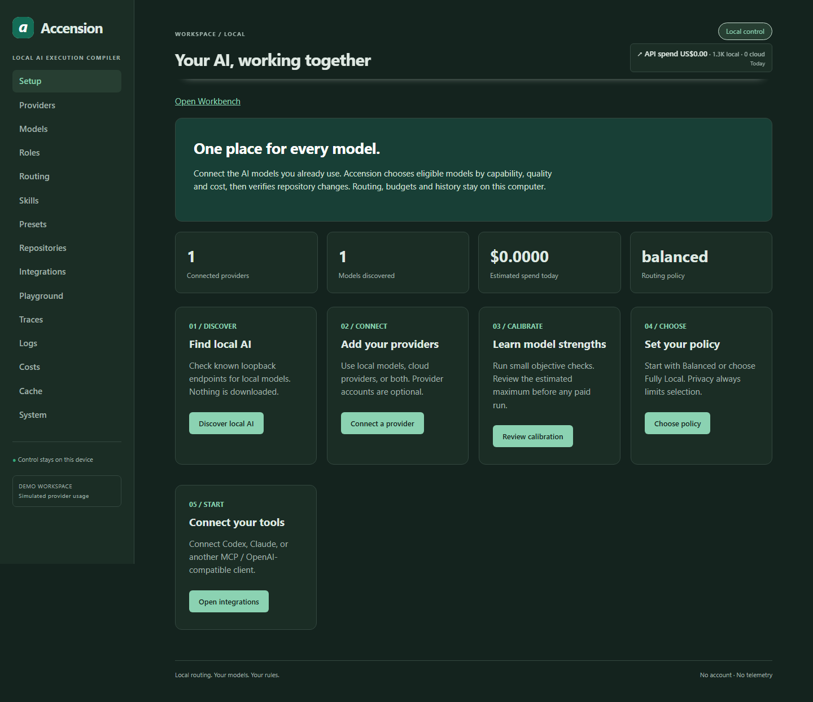

# Providers, models, agents and routing

For users configuring execution. Install Accension and open **Accension settings** first. Reading this guide and planning manual work need no model. [Documentation index](../README.md).

| Term | Meaning | Android example |
|---|---|---|
| Provider | Makes models available through a connection | Ollama serving a local coding model |
| Model | Performs inference: produces text or a proposed change | Proposes a Kotlin login form |
| Role | Describes a responsibility | Coder implements; reviewer checks the proposal |
| Agent | Configured worker with scope, capacity and model policy | Engine worker permitted to change the Android repository |
| Scheduler | Coordinates dependencies and worker capacity | Waits for the API contract before starting the form |
| Skill | Reusable instructions/guidance | Android accessibility conventions |
| Tool | Performs an authorized action | Applying a permitted change or running a registered test |

A desktop assistant is not automatically a separately controllable Workbench worker. Definitions, running instances and provider models have distinct identities. [Codex](../../CODEX_SETUP.md), [Claude](../../CLAUDE_SETUP.md) and [MCP](../../MCP.md) describe supported integrations.

## Configure an eligible model

1. Open **Accension settings → Setup / Providers**. Connect an installed runtime such as Ollama or a cloud provider. Accension does not download weights.
2. Inspect **Models** for capabilities and quality evidence. Unknown capabilities/prices are conservative; review calibration quotes before running.
3. Select **Routing**, repository privacy and budgets. Cloud permission does not override stricter repository rules.
4. Register the Android repository and trusted checks in **Repositories**. Install its dependencies first. A check is executable software you authorize locally.
5. In Workbench **Agents**, configure an Engine worker for that workspace/repository. Choose automatic routing or primary/fallback models per role. Inspect eligibility before assignment.

Eligibility combines capabilities, quality, privacy, price, availability and remaining budget. Primary/fallback models still need to qualify. Assignment picks a worker; routing selects inference for its roles.

*Mock models and demonstration costs; no claim about production quality.*

## Local and cloud boundaries

The database stays local. Authorized cloud inference can send context externally under inherited privacy and egress rules. A cloud-enabled configuration is not fully offline.

Route previews do not execute code. Planning, calibration and inference can consume provider resources. Approved execution can change files and run checks. Skills/plugins/commands are trusted; inspect them before enabling.

Canonical details: [providers](../../PROVIDERS.md), [routing policy](../../ROUTING_POLICY.md), [privacy](../../PRIVACY.md), [skills](../SKILLS.md), [agent contracts](../WORKBENCH_CONTRACTS.md). Continue with [feature execution](feature-delivery.md).
