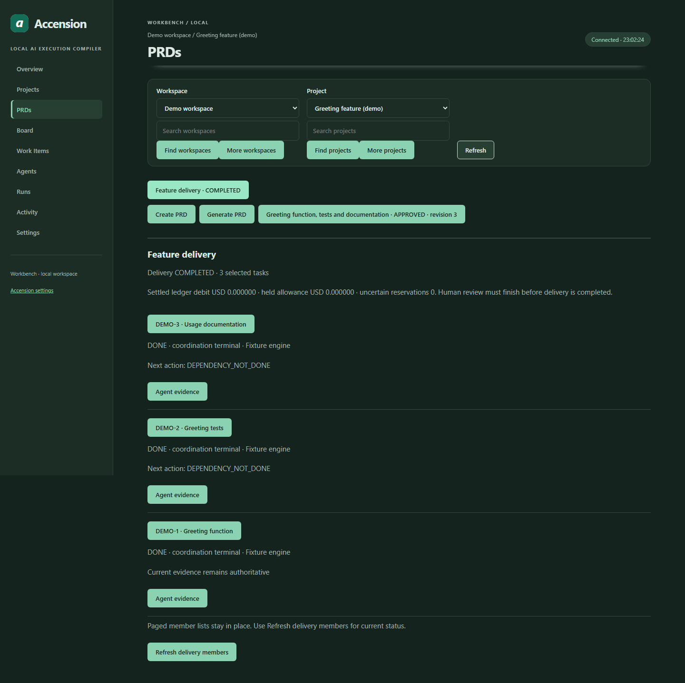

# Current Accension screenshots

Captured on **12 October 2026** from checkout `a4ee53b5`, using the actual local browser application in headless Chromium. Images are direct captures, without generated UI, retouching or substituted metrics. Routing and Workbench use the same packaged Accension logo.

The isolated **Demo workspace / Greeting feature (demo)** uses deterministic mock inference. Three dependent greeting tasks completed through the Engine and scripted human review, with real local unittest checks and persisted receipts verified after reopening the database. A fourth Engine task ran four passing tests and remains in REVIEW. Additional manual tasks and a structured draft PRD demonstrate the forms and board.

These results show the workflow, not production model quality or measured savings. No paid inference, personal repositories, account credentials or live provider data appear in the captures. Unknown usage and prices remain unknown. The mobile image demonstrates a narrow browser viewport, not a paired physical-device test.

| Screenshot | Theme / capture size | README placement |
|---|---|---|
| [Model setup](routing-overview-dark-desktop.png) | Dark / 1440 × 1245 | Connect models and prepare a repository |
| [Workbench board](feature-board-dark-desktop.png) | Dark / 1920 × 1301 | Break the feature into work items |
| [Structured PRD entries](feature-prd-light-desktop.png) | Light / 1440 × 1000 | Write or generate a PRD |
| [Execution review](feature-approval-dark-desktop.png) | Dark / 1440 × 1200 | Configure an agent and review execution |
| [Completion evidence](feature-review-light-desktop.png) | Light / 1440 × 1000 | Inspect checks and approve completion |
| [Agent performance](feature-agents-dark-desktop.png) | Dark / 1440 × 1500 | Inspect agent performance |
| [Mobile board](feature-board-dark-mobile.png) | Dark / 390 × 1661 | Linked from the board tutorial |
| [Completed delivery](feature-delivery-dark-desktop.png) | Dark / 1440 × 1437 | Additional gallery view |

For a LinkedIn post, attach the **Workbench board** first. Add **Completion evidence** as a second image if you want to show the review boundary. Keep the demo description with the post; the pictured metrics are not a benchmark.

## Verified inventory

The [capture manifest](capture-manifest.json) records image hashes/dimensions, capture provenance and current UI asset hashes. Existing images were preserved after comparison with the current isolated browser fixture on 13 October 2026. Historical theme/routing images retain their original dates; missing historical source revisions are labeled, not invented.

| Feature | Guide section |
|---|---|
| Model setup | [Providers, models and agents](../models-and-routing.md#configure-an-eligible-model) |
| Board and mobile board | [Create a project](../workbench.md#create-your-first-project) |
| PRD editor | [Write requirements](../workbench.md#write-a-prd-manually) |
| Execution review | [Separate approval gates](../feature-delivery.md#what-each-decision-means) |
| Completion evidence | [Runs and review](../workbench.md#inspect-runs-review-and-performance) |
| Agent performance | [Performance and provenance](../workbench.md#inspect-runs-review-and-performance) |
| Completed delivery | [Greeting example](../feature-delivery.md#worked-example-greeting-demo) |

## Rebuild captures and LinkedIn media

Install the existing browser extra in a developer environment:

```sh
python -m pip install -e ".[test,dev,browser,lan]"
python -m playwright install chromium
python scripts/capture_docs_screenshots.py --output dist/docs-capture-review
```

The command starts its own loopback service, temporary profile/repository and mock-only providers. It executes actual checks, waits for UI state/fonts, asserts controls, captures six primary screens plus mobile, writes a manifest and stops its owned process. It does not read your working profile. Existing output directories are rejected; failed captures cannot overwrite public images.

Review the fresh images before intentionally replacing gallery files and their manifest. The capture sequence shows an execution review form over previously completed imported tasks without starting a second batch; the completion screen is a separate new attempt awaiting review. Viewport captures retain controls; full results remain in the fixture, not inferred from a picture.

Build the publication package from the verified public originals:

```sh
python scripts/capture_docs_screenshots.py --package-only
```

Output: `dist/media/accension-1.1.0-linkedin/`, containing six unchanged high-resolution PNGs and `README.txt`, plus `dist/media/Accension-1.1.0-LinkedIn-Screenshots.zip`. The ZIP contains the actual files. Generated media stays ignored. No automatic posting occurs.

## Completed delivery



The three completed items have recorded Engine attempts. This capture was taken before the fourth review task was added. Ledger debits shown for mock inference do not establish a real provider's bill.

## Reproduce the workflow

From a developer installation, run:

```sh
python scripts/demo_workbench.py --feature
```

The script creates and cleans up a disposable repository and profile, executes local checks, validates recorded receipts after reopening, and prints its result. For browser screenshot assertions and current UI controls, see the existing [manual UI tests](../../../tests/browser/test_workbench_manual.py), [execution tests](../../../tests/browser/test_workbench_execution_ui.py) and [feature delivery tests](../../../tests/browser/test_workbench_delivery_ui.py).

See the [README tutorial](../../../README.md#workbench), [feature delivery guide](../feature-delivery.md) and [earlier theme gallery](README.md).
