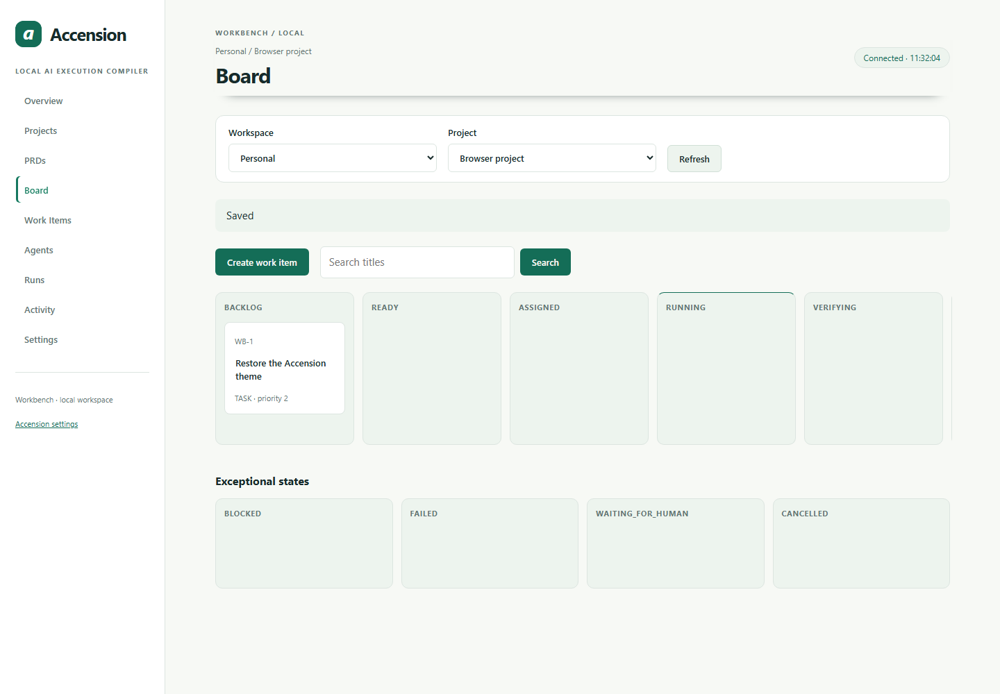
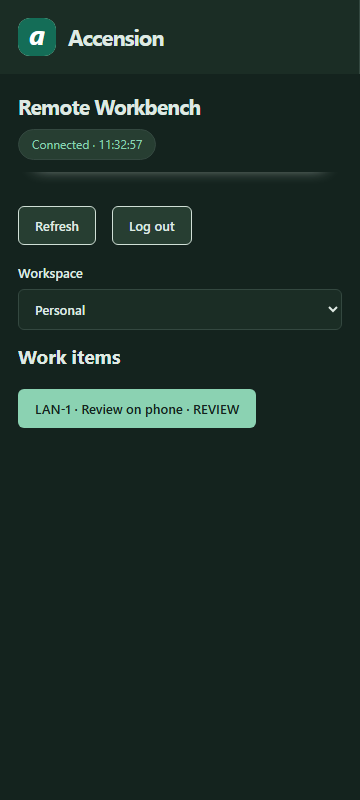

# Workbench tutorial and reference

Workbench organizes projects, requirements and dependent work items. Model routing lives at `/ui`; the Workbench board lives at `/ui/workbench`. Both use the same Engine, configuration and database. The sidebar, logo, typography and light/dark theme belong to one Accension application.

## Open the application

Use the Windows **Accension** shortcut, or run `accs ui` in a source installation and choose **Open Workbench**. The default local URLs are `http://127.0.0.1:8765/ui` and `http://127.0.0.1:8765/ui/workbench`. API clients require their own service token; browser sessions use same-origin cookies and CSRF protection.

## Create your first project

1. Select the **Personal** workspace, open **Projects**, and enter a project name such as *Website maintenance*.
2. Set a short ticket prefix such as *WEB*, save the project, and select it in the Project filter.
3. Open **Board → Create work item**. Enter the title, objective, acceptance criteria and definition of done, then save.
4. Open the ticket to fill its remaining contract: allowed paths, expected artifacts, registered validation, dependencies, capabilities, budget, privacy and review requirements.
5. Mark the item ready only when its contract and prerequisites are complete. Use the returned validation/reason codes to resolve missing fields.

Ticket keys and column states come from stored items. Search matches titles; each column paginates independently. The desktop board scrolls horizontally. At phone widths, **Visible board state** selects a column, including exceptional states. Keyboard users can activate native buttons/selects and use **Skip to workspace**.

## Plan from a PRD

Open **PRDs**, create a document from the bundled template, and fill its requirements. Submit it for review and approve its current revision. Generate/decompose work only after reviewing its quote and privacy/budget constraints. Preview imported proposals before explicitly choosing create/update/keep/archive/successor actions. A generated plan is advice; it does not edit a repository or approve execution. Each execution plan remains bounded by the existing AXIR limit of 64 nodes.

## Execute and review

1. In **Accension settings**, register the repository and trusted test/build commands. Connect models, establish their price/capability evidence, and choose the privacy/routing policy.
2. In Workbench **Agents**, configure the built-in Engine worker, inspect its capabilities and eligibility, and assign the ready item. Missing eligibility is displayed rather than bypassed.
3. Inspect the displayed execution contract, approve the current contract when required, then request execution. Resume dispatch or enable it explicitly when you want queued work to start.
4. Inspect the actual attempt, receipt, checks and artifacts under **Runs** or the item detail. A model response or screenshot alone cannot mark automated work done.
5. Approve the exact completion evidence when human review is required, or reject it with a reason. Changed/stale evidence needs a fresh review.

Manual work records human attestation separately from automated receipts. Repository manual work still needs expected artifacts and registered checks. Automatic verification needs successful independent checks; AI review needs an independent eligible reviewer. If required review is unavailable, work waits for a human.

| State | Meaning |
|---|---|
| BACKLOG / READY | Draft contract / eligible for assignment after prerequisites |
| ASSIGNED / RUNNING | Assigned worker / actual frozen attempt executing |
| VERIFYING / REVIEW | Registered checks / required completion review |
| DONE | Completion criteria and applicable review satisfied |
| BLOCKED / FAILED / WAITING_FOR_HUMAN / CANCELLED | Reason code, failure, escalation or completed cancellation cleanup |

## Pair a second device

LAN is disabled by default. Configure an exact HTTPS origin with a valid issuer/SAN certificate and key. Trust its issuing CA on the client only after checking the fingerprint. Issue a one-time invitation in local Workbench Settings, compare the verification phrase, and approve explicit workspace capabilities. A remote browser gets only those granted actions and can log out. Local provider, credential and repository administration remain unavailable remotely.

Device Only blocks remote browsing and uses local inference. Private LAN permits paired clients while keeping inference local. Hybrid still respects inherited repository/model policies. A private IP alone does not establish provider trust.

## Recovery and troubleshooting

Offline clients keep their displayed view in memory and disable writes. Refresh after reconnect or a retired cursor. A revision conflict requires refreshing current data before retrying; do not reuse an idempotency command ID for changed input. Revoked devices must pair again with host approval.

Cancellation is complete only after worker cleanup and verified rollback. RECONCILING means the known attempt/owner needs inspection, not that a worker stopped. Resume rejects changed files/policy; rollback preserves conflicting human edits. Do not force a second writer after CLEANUP_TIMEOUT. Inspect local service logs and resolve process ownership before restarting.

| Symptom | Next action |
|---|---|
| Old-looking Workbench after installing | Stop an older source hub; run the rebuilt installer; reload the browser |
| No eligible worker/model | Check capability, price, quality, privacy, skills and remaining budget reason codes |
| Revision or evidence conflict | Refresh the item and inspect its latest contract/evidence |
| Remote certificate/session denied | Correct exact certificate trust/origin or inspect host grants/revocation |
| Hub cannot start | Run `accs doctor`; inspect `.router/service.log` in the active profile |

See [Windows operations](windows.md), [architecture](architecture.md), [security](../SECURITY.md) and [CLI command help](../README.md#cli-commands-and-help). Workbench execution does not automatically commit, push or merge Git changes.
